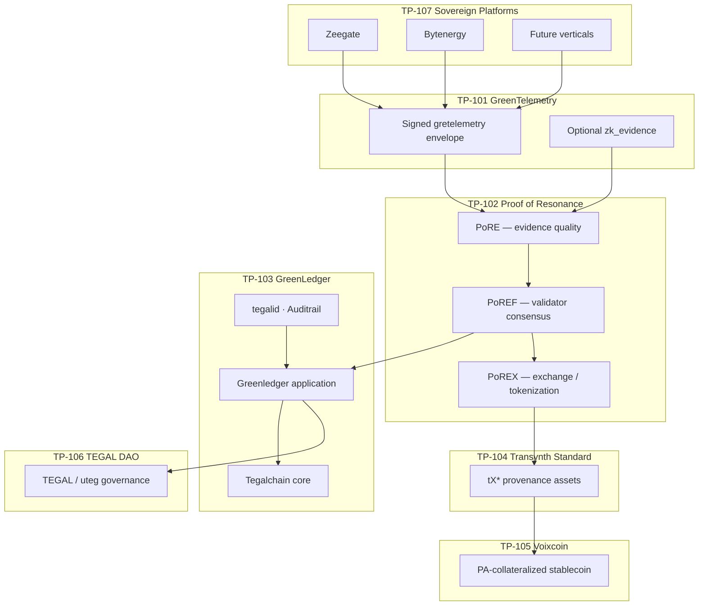

# Sovereign protocol stack

**Canonical (monorepo):** [sovereign-ecosystem/docs/PROTOCOL-STACK.md](https://github.com/Shootle/sovereign-ecosystem/blob/main/docs/PROTOCOL-STACK.md)

Index of **Tegal Protocol (TP)** standards. Subsystems at **TP-107** never talk to the ledger directly — they publish **TP-101** evidence through the gretelemetry oracle in [sovereign-ecosystem](https://github.com/Shootle/sovereign-ecosystem).

**This repo (Tegalchain):** **TP-103** core + **TP-102** / **TP-104–106** CosmWasm target.  
**Monorepo bridge:** Phase 1 mint worker, tegalid gate, mint queue — [PHASE-1.md](https://github.com/Shootle/sovereign-ecosystem/blob/main/docs/phases/PHASE-1.md).

## Stack overview

| Layer | Standard | Purpose | In Tegalchain / ecosystem |
|-------|----------|---------|---------------------------|
| Evidence | **TP-101** GreenTelemetry | Signed telemetry envelope from sovereign nodes | Monorepo — schema, mint worker, Zeegate/Bytenergy clients |
| Trust | **TP-102** Proof of Resonance | Evidence quality, validator consensus, impact verification | **This repo** — PoR docs; full PoREF on Cosmos build |
| Provenance | **TP-103** GreenLedger | Permissioned ledger, tegalid, Auditrail verified records | **This repo** + monorepo Python bridge |
| Asset | **TP-104** Transynth Standard | tX* environmentally provenance assets | **This repo** — `contracts/`, PoREX docs |
| Economic | **TP-105** Voixcoin | PA-collateralized stable value on custodianless ledger | [voixcoin.md](./voixcoin.md) |
| Governance | **TP-106** TEGAL DAO | uteg governance, no pre-mine, impact-gated issuance | [tegal-tokens.md](./tegal-tokens.md), [GOVERNANCE.md](../GOVERNANCE.md) |
| Integration | **TP-107** Sovereign Platforms | Independent DePIN / utility subsystems as producers | Monorepo — `zeegate/`, `bytenergy-utility/`, `zeegate-cloud/` |

## TP-101 — GreenTelemetry

**Standard:** [sovereign-ecosystem/docs/standards/TP-101-GREENTELEMETRY.md](https://github.com/Shootle/sovereign-ecosystem/blob/main/docs/standards/TP-101-GREENTELEMETRY.md)

Produces **GreenTelemetry Records (GTRs)** — vendor-neutral, cryptographically signed environmental telemetry consumed by **TP-103** (archives), **TP-102** (attestation / validator eligibility), and **TP-106** (governance KPIs).

Monorepo only (Replit: clone [sovereign-ecosystem](https://github.com/Shootle/sovereign-ecosystem) alongside this repo, or pull the monorepo and use `tegalchain-core/` as submodule).

| Artifact | Location |
|----------|----------|
| JSON Schema | [greentelemetry-protocol-spec/schema.json](https://github.com/Shootle/sovereign-ecosystem/blob/main/greentelemetry-protocol-spec/schema.json) |
| Oracle ingress | [integrations/mint_worker/](https://github.com/Shootle/sovereign-ecosystem/tree/main/integrations/mint_worker) |
| ZK contract | [GREETELEMETRY-ZK.md](https://github.com/Shootle/sovereign-ecosystem/blob/main/docs/contracts/GREETELEMETRY-ZK.md) |
| Oracle boundary | [GREETELEMETRY-ORACLE-BOUNDARY.md](https://github.com/Shootle/sovereign-ecosystem/blob/main/docs/contracts/GREETELEMETRY-ORACLE-BOUNDARY.md) |

## TP-102 — Proof of Resonance

| Sub-layer | Role |
|-----------|------|
| **PoRE** | Proof of Resonance Evidence — telemetry ingestion, EQS / RIV scoring |
| **PoREF** | Proof of Resonance Foundation — validator network, multi-sig block acceptance |
| **PoREX** | Proof of Resonance Exchange — tokenization, markets, retirement |

| Artifact | Location |
|----------|----------|
| PoR stack overview | [proof-of-resonance-stack.md](./proof-of-resonance-stack.md) |
| Telemetry → PoRE flow | [telemetry-integration.md](./telemetry-integration.md) |
| RFM metrics (EQS, RIV) | [regenerative-finance.md](./regenerative-finance.md) |
| Exchange / tX* mint rules | [proof-of-resonance-exchange.md](./proof-of-resonance-exchange.md) |

## TP-103 — GreenLedger

| Artifact | Location |
|----------|----------|
| Ledger protocol spec | [TEGALCHAIN.md](https://github.com/Shootle/sovereign-ecosystem/blob/main/docs/TEGALCHAIN.md) |
| Python bridge (Phase 1) | [tegalchain/](https://github.com/Shootle/sovereign-ecosystem/tree/main/tegalchain) |
| Chain core | **This repository** — [README.md](../README.md) |
| Tegalid + gretelemetry gate | [TEGALID-GREETELEMETRY.md](https://github.com/Shootle/sovereign-ecosystem/blob/main/docs/contracts/TEGALID-GREETELEMETRY.md) |
| Transaction lifecycle | [transaction-flow.md](./transaction-flow.md) |
| Finality | [finality.md](./finality.md) |

## TP-104 — Transynth Standard

| Artifact | Location |
|----------|----------|
| tX* taxonomy and mint rules | [proof-of-resonance-exchange.md](./proof-of-resonance-exchange.md) |
| CosmWasm workspace | [contracts/](../contracts/) |
| Smart contract overview | [smart-contracts.md](./smart-contracts.md) |

## TP-105 — Voixcoin

| Artifact | Location |
|----------|----------|
| Economic model (canonical) | [VOIXCOIN.md](https://github.com/Shootle/sovereign-ecosystem/blob/main/docs/contracts/VOIXCOIN.md) |
| Summary | [voixcoin.md](./voixcoin.md) |

## TP-106 — TEGAL DAO

| Artifact | Location |
|----------|----------|
| Token policy (canonical) | [TEGAL-TOKENS.md](https://github.com/Shootle/sovereign-ecosystem/blob/main/docs/contracts/TEGAL-TOKENS.md) |
| Summary | [tegal-tokens.md](./tegal-tokens.md) |
| Governance process | [GOVERNANCE.md](../GOVERNANCE.md) |
| Network config / upgrades | [network-configuration.md](./network-configuration.md), [protocol-upgrades.md](./protocol-upgrades.md) |

## TP-107 — Sovereign Platforms

Monorepo platforms — independent producers; no ledger logic embedded.

| Platform | Monorepo path |
|----------|---------------|
| Zeegate (Android DePIN) | [zeegate/](https://github.com/Shootle/sovereign-ecosystem/tree/main/zeegate) |
| Bytenergy utility | [bytenergy-utility/](https://github.com/Shootle/sovereign-ecosystem/tree/main/bytenergy-utility) |
| Zeegate cloud voice (Phase 2) | [zeegate-cloud/](https://github.com/Shootle/sovereign-ecosystem/tree/main/zeegate-cloud) |

## Phase mapping

| Phase | Stack layers delivered |
|-------|------------------------|
| **Phase 1** (current) | **TP-107** producers → **TP-101** validate/sign → **TP-103** tegalid gate + mint queue + submitter |
| **Phase 2** | **TP-107** `zeegate-cloud` voice lab; CDR → adapter → Auditrail |
| **Cosmos target** | Full **TP-102** PoREF/PoREX, **TP-104–106** CosmWasm on **TP-103** core |

## Naming

| TP standard | Common names |
|-------------|--------------|
| TP-101 | `gretelemetry`, `greentelemetry` (protocol); **GreTelemetry** (Android client) |
| TP-103 | **Greenledger** (application on **Tegalchain**) |
| TP-102 sub-layers | PoRE, PoREF, PoREX (not separate TP IDs) |

Glossary: [sovereign-ecosystem/docs/GLOSSARY.md](https://github.com/Shootle/sovereign-ecosystem/blob/main/docs/GLOSSARY.md).
