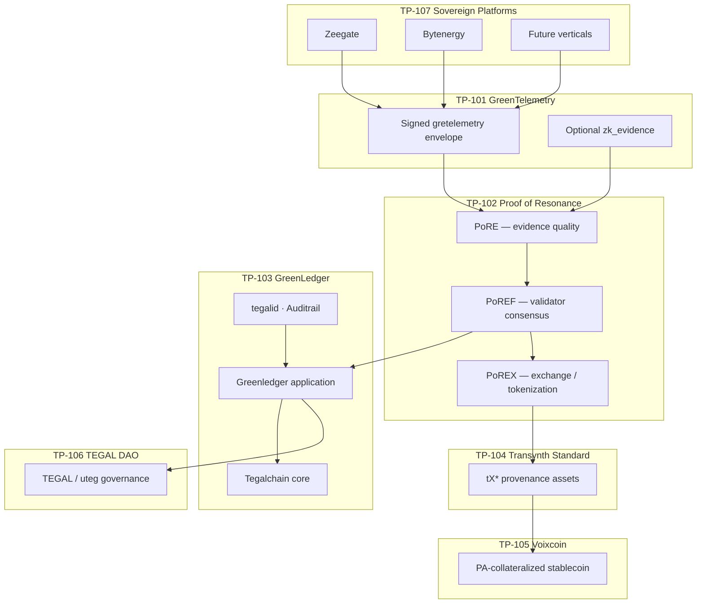

# Sovereign protocol stack

Canonical index of **Tegal Protocol (TP)** standards that compose the sovereign ecosystem. Each layer builds on the one below; subsystems at **TP-107** never talk to the ledger directly — they publish **TP-101** evidence through the gretelemetry oracle.

**Related:** [TEGALCHAIN.md](./TEGALCHAIN.md) (ledger core) · [GLOSSARY.md](./GLOSSARY.md) (naming) · [phases/README.md](./phases/README.md) (delivery roadmap) · [PHASE-1.md](./phases/PHASE-1.md) · [PHASE-2.md](./phases/PHASE-2.md)  
**Replit / submodule mirror:** [tegalchain-core/docs/protocol-stack.md](../tegalchain-core/docs/protocol-stack.md)

## Stack overview

| Layer | Standard | Purpose | Status in repo |
|-------|----------|---------|----------------|
| Evidence | **TP-101** GreenTelemetry | Signed **GTR** evidence envelope from sovereign nodes | **Live** — schema v1.3.0, canonical GTR + legacy normalize |
| Trust | **TP-102** Proof of Resonance | Evidence quality, validator consensus, impact verification | **Partial** — TP-102 standard + RFM scoring live; full PoREF/PoREX on Cosmos target |
| Trust adjunct | **TP-108** AI Attestation | Optional `THIRD_PARTY` plausibility / corroboration on GTRs | **Draft** — [TP-108-AI-ATTESTATION.md](./standards/TP-108-AI-ATTESTATION.md) + schema |
| Provenance | **TP-103** GreenLedger | GLE archival, Auditrail, retention | **Phase 1 live** — GLE on submit + query store |
| Asset | **TP-104** Transynth Standard | tX* environmentally provenance assets | **Specified** — CosmWasm contracts planned |
| Economic | **TP-105** Voixcoin | PA-collateralized stable value on custodianless ledger | **Specified** — vault contract pending |
| Governance | **TP-106** TEGAL DAO | uteg governance, no pre-mine, impact-gated issuance | **Policy documented** — on-chain DAO pending |
| Integration | **TP-107** Sovereign Platforms | Independent DePIN / utility subsystems as producers | **Zeegate + Bytenergy live** — `zeegate-cloud` Phase 2 |

## TP-101 — GreenTelemetry

**Standard:** [standards/TP-101-GREENTELEMETRY.md](./standards/TP-101-GREENTELEMETRY.md)  
**Purpose:** Vendor-neutral environmental telemetry; validated signed payloads are **GreenTelemetry Records (GTRs)** — schema-valid JSON, HMAC identity, optional zero-knowledge proof on **final public evidence** only.

| Artifact | Location |
|----------|----------|
| TP-101 spec (objectives, GTR, consumers) | [standards/TP-101-GREENTELEMETRY.md](./standards/TP-101-GREENTELEMETRY.md) |
| JSON Schema | [greentelemetry-protocol-spec/schema.json](../greentelemetry-protocol-spec/schema.json) |
| Python models / signing | [greentelemetry_protocol_spec/](../greentelemetry_protocol_spec/) |
| Oracle ingress | [integrations/mint_worker/](../integrations/mint_worker/) |
| ZK contract | [contracts/GREETELEMETRY-ZK.md](./contracts/GREETELEMETRY-ZK.md) |
| Oracle boundary | [contracts/GREETELEMETRY-ORACLE-BOUNDARY.md](./contracts/GREETELEMETRY-ORACLE-BOUNDARY.md) |

**Phase 1:** Producers POST signed payloads; worker validates, gates, enqueues `TELEMETRY_MINT` block candidates.

## TP-102 — Proof of Resonance

**Purpose:** Turn raw gretelemetry into trusted, consensus-grade environmental evidence. Three sub-layers:

| Sub-layer | Role |
|-----------|------|
| **PoRE** | Proof of Resonance Evidence — telemetry ingestion, EQS / RIV scoring |
| **PoREF** | Proof of Resonance Foundation — validator network, multi-sig block acceptance |
| **PoREX** | Proof of Resonance Exchange — tokenization, markets, retirement |

| Artifact | Location |
|----------|----------|
| **Normative spec** | [standards/TP-102-PROOF-OF-RESONANCE.md](./standards/TP-102-PROOF-OF-RESONANCE.md) |
| JSON Schema + VERSION | [proof-of-resonance-spec/](../proof-of-resonance-spec/) |
| Python RFM / eligibility | [proof_of_resonance_spec/](../proof_of_resonance_spec/) |
| Bridge scoring | [tegalchain/por/](../tegalchain/por/) |
| PoR stack overview | [tegalchain-core/docs/proof-of-resonance-stack.md](../tegalchain-core/docs/proof-of-resonance-stack.md) |
| Telemetry → PoRE flow | [tegalchain-core/docs/telemetry-integration.md](../tegalchain-core/docs/telemetry-integration.md) |
| RFM metrics (EQS, RIV) | [tegalchain-core/docs/regenerative-finance.md](../tegalchain-core/docs/regenerative-finance.md) |
| Exchange / tX* mint rules | [tegalchain-core/docs/proof-of-resonance-exchange.md](../tegalchain-core/docs/proof-of-resonance-exchange.md) |

**Phase 1:** Oracle endorsement + **RFM scoring** on ledger-bound GTRs (`phase1_oracle` profile); full PoREF validator mesh and on-chain mint gates are **Cosmos SDK target**.

## TP-103 — GreenLedger

**Purpose:** Provenance and archival layer — tamper-evident long-term storage of anchored GTRs as **GreenLedger Entries (GLE)**.

| Artifact | Location |
|----------|----------|
| **Normative spec** | [standards/TP-103-GREENLEDGER.md](./standards/TP-103-GREENLEDGER.md) |
| JSON Schema + VERSION | [green-ledger-spec/](../green-ledger-spec/) |
| Python GLE builder | [green_ledger_spec/](../green_ledger_spec/) |
| Bridge archive | [tegalchain/greenledger/](../tegalchain/greenledger/) |
| Archive store + query | [tegalchain/queue/store.py](../tegalchain/queue/store.py) |
| Auditrail + GLE on submit | [tegalchain/auditrail.py](../tegalchain/auditrail.py) |
| Ledger protocol overview | [TEGALCHAIN.md](./TEGALCHAIN.md) |
| Chain core (submodule) | [tegalchain-core/](../tegalchain-core/) → [Tegalchain/Tegalchain](https://github.com/Tegalchain/Tegalchain) |
| Tegalid + gretelemetry gate | [contracts/TEGALID-GREETELEMETRY.md](./contracts/TEGALID-GREETELEMETRY.md) |

**Phase 1:** Mint queue submit → Auditrail correlation + **GLE archival** in SQLite; `GET /v1/telemetry/records/{gtr_id}` returns `greenledger_entry`.

## TP-104 — Transynth Standard

**Purpose:** On-chain representation of environmentally provenance assets as **Transitional Synthetic Assets (Transynths)** — **tX***, where * is a semantic suffix (`tXcarbon`, `tXbiodiversity`, `tXwater`, `tXsoil`, `tXIREC`, `tXenergy`, `tXtel`).

| Artifact | Location |
|----------|----------|
| tX* taxonomy and mint rules | [tegalchain-core/docs/proof-of-resonance-exchange.md](../tegalchain-core/docs/proof-of-resonance-exchange.md) |
| CosmWasm workspace | [tegalchain-core/contracts/](../tegalchain-core/contracts/) |
| Smart contract overview | [tegalchain-core/docs/smart-contracts.md](../tegalchain-core/docs/smart-contracts.md) |

**Target:** PoREX contracts mint tX* when verified PoRE/PoREF thresholds are met; retirement includes vintage metadata and audit trails.

## TP-105 — Voixcoin

**Purpose:** Stable value unit minted **only** by locking **Provenance Assets (PA)** — primarily tX* with Auditrail + PoRE evidence — in a **non-custodial** Greenledger vault.

| Artifact | Location |
|----------|----------|
| Economic model | [contracts/VOIXCOIN.md](./contracts/VOIXCOIN.md) |
| Submodule mirror | [tegalchain-core/docs/voixcoin.md](../tegalchain-core/docs/voixcoin.md) |

**Target:** Collateral module on CosmWasm; supply fully backed by locked PA on-ledger.

## TP-106 — TEGAL DAO

**Purpose:** Native governance and utility over the Greenledger — **TEGAL** / **uteg**, never pre-mined; allocation tied to verified impact work and DAO policy.

| Artifact | Location |
|----------|----------|
| Token policy | [contracts/TEGAL-TOKENS.md](./contracts/TEGAL-TOKENS.md) |
| Submodule mirror | [tegalchain-core/docs/tegal-tokens.md](../tegalchain-core/docs/tegal-tokens.md) |
| Governance process | [tegalchain-core/GOVERNANCE.md](../tegalchain-core/GOVERNANCE.md) |

**Target:** On-chain proposals, treasury, capability upgrades coordinated with [TEGALCHAIN.md](./TEGALCHAIN.md) network configuration and ACL sections.

## TP-107 — Sovereign Platforms

**Purpose:** Independent subsystem implementations that **produce** gretelemetry; they do not embed ledger logic. Each platform owns its domain stack (telecom, energy, voice lab, …).

| Platform | Location | TP-101 producer |
|----------|----------|-----------------|
| Zeegate (Android DePIN) | [zeegate/](../zeegate/) | `TelemetryService` → mint worker |
| Zeegate Python stub | [integrations/zeegate_telemetry/](../integrations/zeegate_telemetry/) | Lab / CI client |
| Bytenergy utility | [bytenergy-utility/](../bytenergy-utility/) | Energy metrics client |
| Zeegate cloud voice (Phase 2) | [zeegate-cloud/](../zeegate-cloud/) | CDR adapter → mint worker (**live**); live Replit anchor pending |

**Boundary rule:** Subsystems communicate with Tegalchain **exclusively** via [greentelemetry-protocol-spec/schema.json](../greentelemetry-protocol-spec/schema.json) through the oracle — see [GREETELEMETRY-ORACLE-BOUNDARY.md](./contracts/GREETELEMETRY-ORACLE-BOUNDARY.md).

## Phase mapping

| Phase | Stack layers delivered |
|-------|------------------------|
| **Phase 1** (current) | **TP-107** producers → **TP-101** validate/sign → **TP-103** tegalid gate + mint queue + submitter |
| **Phase 2** | **TP-107** `zeegate-cloud` voice lab; adapter-normalized CDR into Auditrail path |
| **Cosmos target** | Full **TP-102** PoREF/PoREX, **TP-104–106** CosmWasm modules on **TP-103** core |

## Naming

| TP standard | Common repo names |
|-------------|-------------------|
| TP-101 | `gretelemetry`, `greentelemetry` (protocol); **GreTelemetry** (Android client) |
| TP-103 | **Greenledger** (application on **Tegalchain**) |
| TP-102 sub-layers | PoRE, PoREF, PoREX (not separate TP IDs) |

See [GLOSSARY.md](./GLOSSARY.md) for full naming rules.
