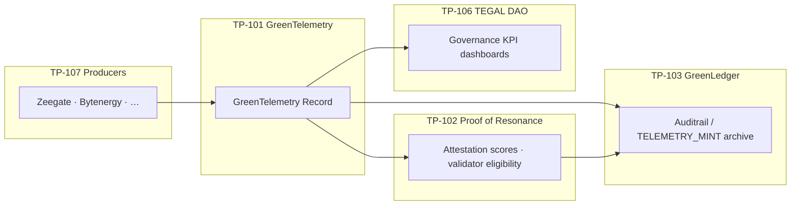

# TP-101 — GreenTelemetry Protocol

**Standard ID:** TP-101  
**Status:** Live (schema v1.3.0, mint worker, sovereign platform producers)  
**Canonical schema:** [greentelemetry-protocol-spec/schema.json](../../greentelemetry-protocol-spec/schema.json)

The **GreenTelemetry Protocol** defines a vendor-neutral, device-agnostic envelope for environmental and sustainability telemetry from sovereign edge nodes. A validated, signed payload is a **GreenTelemetry Record (GTR)**.

**Naming:** `gretelemetry` / `greentelemetry` = this protocol; **GreTelemetry** = Zeegate Android client helper. See [GLOSSARY.md](../GLOSSARY.md).

## TP-101 GTR data model (schema_version `1.0`)

Canonical atomic unit of environmental evidence:

| Field | Type | Requirement | Description |
|-------|------|-------------|-------------|
| `gtr_id` | UUID v4 | MUST | Unique record identifier |
| `source_id` | string(64) | MUST | Sensor or reporting entity identifier |
| `source_type` | enum | MUST | `SENSOR`, `MANUAL`, `CERTIFIED_AUDITOR`, `API` |
| `measurement_type` | enum | MUST | See measurement types below |
| `value` | decimal | MUST | Measured quantity |
| `unit` | string(16) | MUST | SI unit or approved derivative |
| `timestamp` | ISO 8601 UTC | MUST | Measurement time (`…Z`) |
| `location` | GeoPoint | SHOULD | WGS-84 coordinates |
| `attestations` | list[Attestation] | MUST | Minimum one attestation |
| `metadata` | JSON object | MAY | Additional key-value properties |
| `schema_version` | semver | MUST | Must equal `"1.0"` for this specification |

**Tegalid extensions (v1.3 wire protocol):** optional `project_id`, `binding_id`, `zk_evidence` on canonical GTR payloads.

### Measurement types

| Code | Description | Base unit (approved) |
|------|-------------|----------------------|
| `CO2E` | Carbon dioxide equivalent | `kg CO2e`, `kgCO2e`, `tCO2e` |
| `CH4` | Methane emissions | `kg`, `g`, `t` |
| `N2O` | Nitrous oxide emissions | `kg`, `g`, `t` |
| `ENERGY_KWH` | Electrical energy consumed/generated | `kWh`, `MWh`, `Wh` |
| `ENERGY_MJ` | Thermal energy consumed | `MJ`, `GJ`, `kJ` |
| `WATER_M3` | Water consumption | `m3`, `L`, `ML` |
| `BIODIVERSITY` | Species count or habitat area | `count`, `ha`, `m2` |
| `OFFSET_CREDIT` | Verified carbon offset unit | `tCO2e`, `credit` |
| `CUSTOM` | Implementation-defined type | as declared in `unit` (≤16 chars) |

Attestation methods: Ed25519 over the GTR canonical hash (SHA-256 of pre-attestation JSON). Multiple attestations increase trust score.

### Attestation object

| Field | Type | Requirement | Description |
|-------|------|-------------|-------------|
| `attester_id` | string(64) | MUST | DID or registered attester identifier |
| `attester_type` | enum | MUST | `DEVICE`, `OPERATOR`, `THIRD_PARTY`, `REGULATORY` |
| `signature` | bytes(64) | MUST | Ed25519 signature over GTR canonical hash (hex on wire) |
| `timestamp` | ISO 8601 | MUST | Time of attestation |
| `confidence` | decimal(3,2) | SHOULD | Confidence score 0.00–1.00 |
| `metadata` | JSON object | MAY | e.g. `legacy_sig: true` + `algorithm` for RSA / ECDSA P-256; **`tp108`** for AI attestation — [TP-108-AI-ATTESTATION.md](./TP-108-AI-ATTESTATION.md) |

Legacy `signature` (HMAC) on node envelopes is verified at the oracle, then normalized to a `DEVICE` attestation using the same producer secret (lab: derived Ed25519 key from HMAC secret).

## Ingestion interface

Implementations **MUST** support at least one transport:

| Transport | Status in repo | Use case |
|-----------|----------------|----------|
| **HTTPS REST** | **Live** — `integrations/mint_worker` | Batch submission, manual reporting |
| **MQTT v5** | **Live** — `mqtt_bridge.py` | Real-time IoT streams (`gtp/{source_id}/…`) |
| **WebSocket** | **Target** | Streaming dashboard integrations |

Production HTTPS MUST use **TLS 1.3+**. Set `MINT_WORKER_BEARER_TOKEN` and optionally `TEGALCHAIN_REQUIRE_BEARER=1` so **all** REST endpoints require `Authorization: Bearer <token>` (OAuth 2.0 compatible). Tegalchain-native DID-based authentication is reserved for a future release.

### On-chain anchoring (TP-103)

Each accepted GTR produces an on-chain anchor transaction on the Tegalchain ledger. The **full GTR payload is NOT stored on-chain** — only the hash and summary fields. Full records are retained in the TP-103 GreenLedger mint queue / Auditrail store (**7-year** minimum retention via `MintQueueStore` query APIs).

| Field | Description |
|-------|-------------|
| `gtr_id` | Unique record identifier |
| `content_hash` | SHA-256 of the canonical GTR JSON |
| `attester_ids` | List of attester identifiers |
| `measurement_type` | Measurement type code |
| `timestamp` | Measurement timestamp |
| `anchor_timestamp` | Block / submit time of on-chain inclusion |

Implementation: [`tegalchain/anchor.py`](../../tegalchain/anchor.py) builds `GTR_ANCHOR` on ingest; [`tegalchain/submitter/drain.py`](../../tegalchain/submitter/drain.py) sets `anchor_timestamp` at ordering. Accepted records SHOULD be anchored within **60 seconds** (`ANCHOR_SLA_SECONDS` in [`greentelemetry_protocol_spec/security.py`](../../greentelemetry_protocol_spec/security.py)).

#### Merkle batching

When throughput exceeds **100 records per second**, implementations **SHOULD** batch multiple GTR `content_hash` values into a Merkle tree and anchor only the root hash per block. Set `TEGALCHAIN_MERKLE_BATCH=1` on the submitter to attach `GTR_MERKLE_BATCH` metadata and per-record `merkle_proof` siblings. Individual inclusion MUST be verifiable via [`tegalchain/block.py`](../../tegalchain/block.py) `verify_merkle_proof()`.

### Security requirements

| Requirement | Implementation |
|-------------|----------------|
| Authenticated API | [`integrations/mint_worker/auth.py`](../../integrations/mint_worker/auth.py) — Bearer when token configured or `TEGALCHAIN_REQUIRE_BEARER=1` |
| Ed25519 attestations | Default; 128-char hex signature over GTR canonical hash |
| Legacy RSA / ECDSA P-256 | Permitted only with `"legacy_sig": true` and `"algorithm"` in attestation `metadata` |
| Attestation replay window | Attestation `timestamp` MUST be within **±5 minutes** of measurement `timestamp` |
| Batch rate limit | **10,000** records per `source_id` per hour (`source_rate_limits` in mint queue DB) |
| Registered sources | `source_id` MUST appear in the Tegalchain Identity Registry when `TEGALCHAIN_REQUIRE_SOURCE_REGISTRY=1` or identity mode is `tegalid` — [`tegalchain/source_registry.py`](../../tegalchain/source_registry.py) |

### Conformance criteria (TP-101)

An implementation is conformant if it:

1. Accepts GTR submissions via at least one MUST-level transport (**REST** and optional **MQTT v5** bridge in [`mqtt_bridge.py`](../../integrations/mint_worker/mqtt_bridge.py); topic patterns in [`mqtt_topics.py`](../../integrations/mint_worker/mqtt_topics.py)).
2. Validates all MUST fields against [schema.json](../../greentelemetry-protocol-spec/schema.json).
3. Anchors accepted GTRs to Tegalchain within **60 seconds** of acceptance (submitter drain + `anchor_timestamp`).
4. Rejects GTRs with invalid or missing attestation signatures.
5. Maintains a query interface returning full GTR data for at least **7 years** (`GET /v1/telemetry/records/{gtr_id}` backed by mint queue retention).

### REST API

| Method | Path | Response |
|--------|------|----------|
| `POST` | `/v1/telemetry/records` | **201** — `{ gtr_id, ledger_ref, queue_id, status }` |
| `POST` | `/v1/telemetry/batch` | **202** — `{ batch_id, … }` (max **1,000** records) |
| `GET` | `/v1/telemetry/records/{gtr_id}` | GTR + attestations + `ledger_ref` |
| `GET` | `/v1/telemetry/batch/{batch_id}` | Batch status |
| `POST` | `/v1/telemetry` | Legacy Phase 1 response |

`ledger_ref` = on-chain / Qortal tx hash when queue status is `submitted`; `null` while pending.

### MQTT v5 topics

| Topic | Direction | Description |
|-------|-----------|-------------|
| `gtp/{source_id}/readings` | Publish | Sensor publishes GTR JSON |
| `gtp/{source_id}/ack` | Subscribe | Anchoring ack (`gtr_id`, `queue_id`, `status`, `ledger_ref`) |
| `gtp/{source_id}/errors` | Subscribe | Validation / delivery errors (`error`, `status_code`, `source_id`) |

Enable with `MINT_WORKER_MQTT_ENABLED=1`. The bridge subscribes to `gtp/+/readings`, runs the same `ingest_payload()` pipeline as REST, and publishes ack/error JSON on the matching source topics. When Bearer auth is required, set `MINT_WORKER_MQTT_PASSWORD` (defaults to `MINT_WORKER_BEARER_TOKEN`) and connect with username `gtp`.

Standalone process (shares mint queue DB with REST):

```bash
export MINT_WORKER_MQTT_ENABLED=1
export MINT_WORKER_MQTT_BROKER=localhost
export TEGALCHAIN_MINT_QUEUE_DB=tegalchain/data/mint_queue.db
python -m integrations.mint_worker.mqtt_bridge
```

Or start the HTTP worker with `MINT_WORKER_MQTT_ENABLED=1` — the bridge runs in a background thread via FastAPI lifespan.

## Comparison: legacy envelope vs canonical GTR

Greentelemetry **v1.3.0** accepts either shape (`oneOf` in [schema.json](../../greentelemetry-protocol-spec/schema.json)). The oracle **normalizes all ingress to TP-101 GTR** before mint queue / ledger handoff.

| TP-101 GTR | Legacy `SovereignNodeTelemetry` (v1.x) | Notes |
|------------|------------------------------------------|-------|
| `gtr_id` | *(generated at oracle)* | UUID v4 assigned on legacy normalize |
| `source_id` | `node_id` | Max 64 chars; tegalid DID in production |
| `source_type` | *(default `API`)* | Edge clients → `SENSOR` recommended |
| `measurement_type` + `value` + `unit` | `system_type` + `metrics.*` | See mapping below |
| `timestamp` (ISO 8601) | `timestamp` (unix int) | Converted at normalize |
| `location` | optional `location` | Added to legacy schema v1.3 |
| `attestations[]` | top-level `signature` | Legacy HMAC verified → `DEVICE` Ed25519 attestation |
| `metadata` | — | Legacy `system_type` preserved here |
| `schema_version` `"1.0"` | — | Distinct from wire protocol semver (1.3.0) |
| `project_id` / `binding_id` | same | Tegalid gate |
| `zk_evidence` | same | Optional ZK on final evidence |

### Legacy metric mapping (Phase 1 producers)

| Legacy producer | Maps to GTR |
|-----------------|-------------|
| `ZEEGATE_TELECOM` · `telecom_bandwidth_bytes` | `CUSTOM` · value=bytes · unit=`bytes` · metadata.`system_type` |
| `BYTENERGY_UTILITY` · `energy_generation_kwh` | `ENERGY_KWH` · unit=`kWh` |

Phase 1 producers may continue posting legacy JSON; new integrations SHOULD emit canonical GTR v1 directly.

## Objectives

The GreenTelemetry Protocol is designed to:

1. **Provide a vendor-neutral, device-agnostic interface** for environmental sensor data — producers declare a `system_type` and schema-valid `metrics`; the oracle never branches on hardware or OS internals ([GREETELEMETRY-ORACLE-BOUNDARY.md](../contracts/GREETELEMETRY-ORACLE-BOUNDARY.md)).
2. **Ensure cryptographic integrity** of telemetry readings from point of origin to ledger anchor — HMAC-signed envelopes, optional `zk_evidence` on final public evidence, tegalid identity lock, and `TELEMETRY_MINT` block candidates anchored on **TP-103** GreenLedger.
3. **Enable multi-party attestation** of environmental claims — oracle endorsement in Phase 1; **TP-102** PoREF validator mesh and per-contract endorsement policies on the Cosmos target.
4. **Support both real-time streaming and batched reporting modes** — each GTR carries a monotonic `timestamp`; producers may POST individually (near-real-time) or aggregate locally and submit batches of signed records (same envelope, independent signatures).
5. **Interoperate with existing regulatory reporting frameworks** — GHG Protocol, ISO 14064, and TCFD alignment via adapter-normalized fields and Auditrail archives (**target** export mappers; not a compliance certification by itself).

## GreenTelemetry Record (GTR)

A **GTR** is a schema-valid TP-101 record (`schema_version: "1.0"`) or a legacy `SovereignNodeTelemetry` envelope normalized to that form at the oracle. After verification (attestations / HMAC, tegalid gate, optional ZK) it is eligible for mint queue / ledger anchor.

| Stage | Artifact |
|-------|----------|
| Origin | Producer signs canonical JSON (`node_id`, `timestamp`, `system_type`, `metrics`, …) |
| Ingress | Mint worker validates against [schema.json](../../greentelemetry-protocol-spec/schema.json) |
| Trust edge | HMAC verify · tegalid binding · optional `zk_evidence` |
| Ledger handoff | `block_candidate` (`TELEMETRY_MINT`) → mint queue → submitter / Auditrail (**TP-103**) |

## Relationship to other standards

TP-101 produces **GTRs** consumed by:

| Consumer | Role |
|----------|------|
| **TP-103 GreenLedger** | Stores long-term GTR archives (Auditrail verified records, state keys on `TELEMETRY_MINT`) |
| **TP-102 Proof of Resonance** | Uses GTR attestation scores (EQS, RIV, consensus confidence) as validator eligibility and block-acceptance signals |
| **TP-106 TEGAL DAO** | Environmental KPIs derived from aggregated GTRs inform governance dashboards and impact-gated uteg allocation |

Downstream asset and economic layers (**TP-104** Transynths, **TP-105** Voixcoin) consume **verified** evidence produced after **TP-102** processes GTRs — not raw producer payloads.



## Implementation in this repo

| Objective | Phase 1 | Target |
|-----------|---------|--------|
| Vendor-neutral envelope | `system_type` + `metrics` in schema | New verticals via minor schema bump |
| Cryptographic integrity | HMAC, tegalid gate, mint queue hash dedupe | On-chain ZK verify (`x/auditrail`) |
| Multi-party attestation | Single-oracle endorsement on `block_candidate` | PoREF validators + contract endorsement policies |
| Streaming / batch | HTTP `POST /v1/telemetry` per GTR; header `X-Gretelemetry-Reporting-Mode: stream\|batch` | Optional batch ingest API; streaming adapter |
| Regulatory interoperability | Metric fields map to domain evidence | GHG / ISO 14064 / TCFD export adapters on Auditrail |

| Artifact | Location |
|----------|----------|
| JSON Schema | [greentelemetry-protocol-spec/](../../greentelemetry-protocol-spec/) |
| Python models / signing | [greentelemetry_protocol_spec/](../../greentelemetry_protocol_spec/) (`Tp101GreenTelemetryRecord`, normalize, units) |
| Normalization | [greentelemetry_protocol_spec/normalize.py](../../greentelemetry_protocol_spec/normalize.py) |
| GTR ledger binding | [tegalchain/gtr.py](../../tegalchain/gtr.py) |
| Oracle ingress | [integrations/mint_worker/](../../integrations/mint_worker/) (REST + MQTT v5 bridge) |
| Tegalid gate | [TEGALID-GREETELEMETRY.md](../contracts/TEGALID-GREETELEMETRY.md) |
| ZK on final evidence | [GREETELEMETRY-ZK.md](../contracts/GREETELEMETRY-ZK.md) |
| Stack index | [PROTOCOL-STACK.md](../PROTOCOL-STACK.md) |

## Related standards

- [PROTOCOL-STACK.md](../PROTOCOL-STACK.md) — full TP-101–107 index
- [TEGALCHAIN.md](../TEGALCHAIN.md) — permissioned ledger core (**TP-103** infrastructure)
- [TP-103-GREENLEDGER.md](./TP-103-GREENLEDGER.md) — **TP-103** GLE archival and retention
- [tegalchain-core/docs/proof-of-resonance-stack.md](../../tegalchain-core/docs/proof-of-resonance-stack.md) — **TP-102** PoR sub-layers
- [TP-102-PROOF-OF-RESONANCE.md](./TP-102-PROOF-OF-RESONANCE.md) — **TP-102** normative spec (RFM, Resonance, eligibility)
- [TEGAL-TOKENS.md](../contracts/TEGAL-TOKENS.md) — **TP-106**
