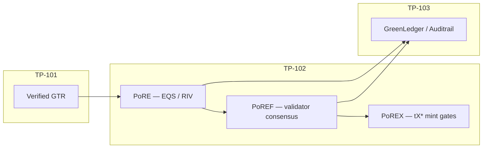

# TP-102 — Proof of Resonance Protocol

**Standard ID:** TP-102  
**Version:** 1.0.0  
**Status:** Draft  
**Layer:** Trust  
**Canonical schema:** [proof-of-resonance-spec/schema.json](../../proof-of-resonance-spec/schema.json)

The **Proof of Resonance Protocol (TP-102)** defines the consensus and validator eligibility mechanism for the Tegalchain Sovereign Ecosystem. It replaces energy-intensive proof-of-work and stake-concentration-prone proof-of-stake with a multi-dimensional alignment scoring system called **Resonance**.

Resonance measures the degree to which a validator's behaviour, environmental footprint, governance participation, and protocol compliance align with the constitutional principles of the Tegalchain ecosystem. Validators with higher Resonance scores are granted greater block production rights and governance influence.

**Naming:** PoR stack sub-layers — **PoRE** (evidence), **PoREF** (foundation validators), **PoREX** (exchange / tX*) — are architectural layers within TP-102, not separate TP IDs. See [GLOSSARY.md](../GLOSSARY.md).

## Relationship to adjacent standards

| Standard | Role |
|----------|------|
| **TP-101** GreenTelemetry | Produces verified **GTRs** — sole input to PoRE scoring |
| **TP-108** AI Attestation | Optional `THIRD_PARTY` claims; MAY adjust EQS under `AI_AUGMENTED` profile (draft) |
| **TP-103** GreenLedger | Archives evidence commitments and anchor metadata |
| **TP-104** Transynths | Mints tX* when PoREX thresholds met |
| **TP-105** Voixcoin | Uses RIV / oracle marks for collateral policy |
| **TP-106** TEGAL DAO | Governance weight from validator Resonance |

Raw producer telemetry MUST NOT enter TP-102 directly. Only GTRs verified at the TP-101 oracle edge (signatures, tegalid gate, optional ZK) are eligible for RFM scoring.



## PoR stack sub-layers

| Sub-layer | Name | Responsibility |
|-----------|------|----------------|
| **PoRE** | Proof of Resonance Evidence | Score verified GTRs → **RFM** (EQS, RIV, evidence resonance) |
| **PoREF** | Proof of Resonance Foundation | Validator mesh, multi-sig block acceptance, **Consensus Confidence** |
| **PoREX** | Proof of Resonance Exchange | tX* mint, markets, retirement when RFM + PoREF thresholds met |

Green energy remains a **mandatory requirement** for block creation on the Tegalchain ledger. PoR extends verification to all environmental attributes and ensures evidence quality and consensus confidence before minting **Transitional Synthetic Assets (Transynths)** — **tXcarbon**, **tXbiodiversity**, **tXwater**, **tXsoil**, **tXIREC**, **tXenergy**, **tXtel**.

Submodule overview: [tegalchain-core/docs/proof-of-resonance-stack.md](../../tegalchain-core/docs/proof-of-resonance-stack.md)

## Design principles

The Proof of Resonance mechanism is governed by four design principles:

1. **Alignment over wealth** — validator influence is proportional to demonstrated alignment with ecosystem values, not to token holdings alone.
2. **Environmental accountability** — validators MUST provide verifiable environmental telemetry as a condition of eligibility.
3. **Dynamic rebalancing** — Resonance scores update continuously based on on-chain observable behaviour.
4. **Sybil resistance** — identity-binding via the Tegalchain Identity Registry prevents gaming through multiple validator identities.

## Resonance model

Two Resonance concepts apply at different layers:

| Profile | Subject | Range | Purpose |
|---------|---------|-------|---------|
| **Validator Resonance (R)** | PoREF validator | 0.0–1.0 | Block production rights, governance weight |
| **Evidence Resonance** | One verified GTR (RFM) | 0–100 | PoREX mint gates, Auditrail ranking |

### Validator Resonance Score (R)

A validator's **Resonance Score (R)** is a composite decimal in **[0.0, 1.0]** computed across four dimensions:

| Dimension | Weight | Symbol | Description |
|-----------|--------|--------|-------------|
| Environmental | 30% | R_env | GreenTelemetry compliance and carbon footprint |
| Governance | 25% | R_gov | Proposal participation and voting consistency |
| Uptime | 25% | R_up | Block production reliability and latency |
| Compliance | 20% | R_cmp | Protocol rule adherence and slashing history |

```
R = (0.30 × R_env) + (0.25 × R_gov) + (0.25 × R_up) + (0.20 × R_cmp)
```

Default eligibility thresholds (configurable on-chain):

| Capability | Minimum R | Additional floor |
|------------|-----------|------------------|
| Block production | 0.40 | R_env ≥ 0.20 |
| Governance voting | 0.40 | Identity ACTIVE |

Implementation: [`proof_of_resonance_spec/resonance.py`](../../proof_of_resonance_spec/resonance.py), [`proof_of_resonance_spec/eligibility.py`](../../proof_of_resonance_spec/eligibility.py), [`proof_of_resonance_spec/lifecycle.py`](../../proof_of_resonance_spec/lifecycle.py)

#### Environmental dimension (R_env)

R_env is derived from the validator's **GreenTelemetry data (TP-101)**:

- Validators **MUST** submit at least one attested GTR per calendar month, independently of the block-epoch boundary.
- R_env is computed as a function of:
  - **Carbon intensity** — kWh consumed per block validated, normalised against the network median
  - **Renewable ratio** — percentage of energy sourced from certified renewables
  - **Offset coverage** — proportion of residual emissions offset with TP-101 certified credits

Validators with **zero GTR submissions in a calendar month** receive **R_env = 0.0** for the epoch(s) within that month and are **ineligible for block production** until at least one attestation is recorded for the current month.

Phase 1 reference (when monthly GTRs are present):

```
carbon_factor = 1 − min(1, carbon_intensity / network_median)
R_env = 0.40 × carbon_factor + 0.35 × renewable_ratio + 0.25 × offset_coverage
```

#### Governance dimension (R_gov)

R_gov measures active participation in **TP-106** governance events:

- Vote participation rate across all proposals in the epoch
- Consistency of vote with stated validator policy positions
- Quality of authored proposals (measured by acceptance rate)

Validators that abstain from more than **40%** of governance votes in an epoch receive a governance penalty of **−0.10** applied to R_gov.

```
R_gov = 0.50 × participation + 0.30 × policy_consistency + 0.20 × proposal_acceptance
if abstention_rate > 0.40: R_gov -= 0.10
```

#### Uptime dimension (R_up)

R_up is computed from the block production record:

```
R_up = (blocks_produced / blocks_assigned) × latency_factor
```

`latency_factor` is **1.0** for median propagation time and decreases **linearly to 0.5** for validators whose block propagation time exceeds the **95th percentile**.

#### Compliance dimension (R_cmp)

R_cmp begins at **1.0** and is decremented by slashing events:

| Offence | R_cmp penalty |
|---------|---------------|
| Double-signing | −0.40 |
| Equivocation in finality round | −0.20 |
| Invalid block submission | −0.15 |
| GTR timestamp violation | −0.10 |
| API rate limit abuse | −0.05 |
| Fabricated GTR data | Permanent (R_cmp = 0.0) |

Penalties **decay at 0.02 per epoch** if no further offences are recorded (except fabricated GTR).

## Validator lifecycle

### Registration

To register as a validator, an entity **MUST**:

1. Possess a valid **Tegalchain Identity Registry** entry with at least **Tier 2** verification
2. Stake a minimum of **10,000 TEGAL** tokens in the Validator Bond Contract
3. Submit an initial **GreenTelemetry baseline report (TP-101)** covering the preceding **90 days**
4. Declare operational jurisdiction, infrastructure provider, and energy source attestations
5. Submit a **Validator Policy Statement** accessible via a stable public URI

Reference: [`proof_of_resonance_spec/lifecycle.py`](../../proof_of_resonance_spec/lifecycle.py) — `validate_registration()`

### Eligibility

A validator is eligible for block production in a given epoch if **all** of the following hold:

| Criterion | Requirement |
|-----------|-------------|
| Composite Resonance | R ≥ **0.40** |
| Environmental floor | R_env ≥ **0.20** |
| Bond status | Not in a slashing dispute |
| Identity | Status **ACTIVE** in the Identity Registry |
| Monthly GTR | At least one attested GTR in the current calendar month |

Reference: [`proof_of_resonance_spec/lifecycle.py`](../../proof_of_resonance_spec/lifecycle.py) — `is_eligible_for_block_production()`

### Suspension and ejection

| Condition | Action |
|-----------|--------|
| R < 0.40 for **3 consecutive epochs** | Automatic suspension; excluded from block production |
| **Double-signing** offence | Immediate suspension pending governance review |
| Bond value falls below **8,000 TEGAL** | Grace period of **7 days** to top up; suspension if unresolved |
| Identity status set to **REVOKED** | Immediate permanent ejection |

Reference: [`proof_of_resonance_spec/lifecycle.py`](../../proof_of_resonance_spec/lifecycle.py) — `suspension_action()`

## Block production

### Validator set selection

At the start of each **epoch** (every **1,000 blocks**):

1. All eligible validators (Section 3.2) are ranked by Resonance Score in **descending** order
2. The top **N** validators form the active set, where **N = min(100, eligible_count)**
3. Block assignments within the epoch are distributed **proportionally to R**

Reference: [`proof_of_resonance_spec/block_production.py`](../../proof_of_resonance_spec/block_production.py)

### Leader rotation

Within each epoch, block production leaders are rotated using a **Verifiable Random Function (VRF)** seeded from the previous epoch's final block hash. The VRF output for each slot is **weighted by each validator's Resonance Score**, giving higher-scoring validators proportionally more slots.

Reference: `assign_slot_leader()` in [`block_production.py`](../../proof_of_resonance_spec/block_production.py)

### Byzantine fault tolerance

The protocol tolerates up to **⌊(N − 1) / 3⌋** Byzantine validators in the active set. Block finality requires a **2/3 + 1** supermajority of signatures from the active validator set.

```
max_byzantine = (N - 1) // 3
finality_threshold = (2 * N) // 3 + 1
```

## Slashing

Slashing removes a portion of a validator's bond and applies a Resonance penalty.

### Slash conditions

| Condition | Bond slash | R_cmp penalty |
|-----------|------------|---------------|
| Provable double-signing | 10% of bond | −0.40 |
| Equivocation in finality round | 5% of bond | −0.20 |
| Fabricated GTR data | 20% of bond + ejection | Permanent |

Reference: [`proof_of_resonance_spec/slashing.py`](../../proof_of_resonance_spec/slashing.py)

### Slash evidence submission

Any network participant **MAY** submit slash evidence. Evidence **MUST** include:

- The offending validator's identity
- Cryptographic proof of the violation (e.g. two conflicting signed block headers)
- The block heights or timestamps of the violation

Evidence is processed by the **Governance Contract (TP-106)**. Valid evidence triggers an automatic **preliminary slash**; a governance vote determines whether the full penalty applies.

## Resonance score update schedule

| Dimension | Update frequency |
|-----------|------------------|
| **R_up** | Per block (rolling 1,000-block window) |
| **R_env** | Per epoch (when new GTR data is received) |
| **R_gov** | Per epoch (after governance event closes) |
| **R_cmp** | Immediately on slashing event; decay per epoch |

## Regenerative Finance Metrics (RFM)

PoRE outputs an **RFM** record per verified GTR.

| Metric | Range | Description |
|--------|-------|-------------|
| **EQS** (Evidence Quality Score) | 0.0–1.0 | Attestation trust, source-type weighting, optional tegalid binding factor |
| **RIV** (Regenerative Impact Value) | ≥ 0 | Normalized impact from `measurement_type`, `value`, `unit` |
| **Consensus Confidence** | 0.0–1.0 | PoREF validator vote aggregation |
| **Evidence Resonance** | 0–100 | Composite centile from EQS + RIV + Consensus Confidence |

### EQS (Phase 1 reference formula)

```
trust = gtr_trust_score(gtr)          # TP-101 attestation heuristic
source_factor = SOURCE_TYPE_WEIGHT[gtr.source_type]
eqs = trust × source_factor
if binding_attestation_score is set:
  eqs = min(1.0, eqs × 0.7 + (binding_attestation_score / 100) × 0.3)
```

**Important:** `binding_attestation_score` is the **Tegalid identity gate** score from [`tegalchain/tegalid_gate.py`](../../tegalchain/tegalid_gate.py). It MUST NOT be conflated with EQS.

### RIV (Phase 1 reference formula)

```
riv = abs(gtr.value) × MEASUREMENT_WEIGHT[gtr.measurement_type]
```

Weights are defined in [`proof_of_resonance_spec/rfm.py`](../../proof_of_resonance_spec/rfm.py).

### Evidence Resonance

```
riv_factor = min(1.0, riv / 1000)   # normalization constant (Phase 1 lab)
resonance_score = round(
  (eqs × 0.5 + riv_factor × 0.25 + consensus_confidence × 0.25) × 100
)
```

## Validator classes (PoREF)

| Class | Scope | Typical GTR focus |
|-------|-------|-------------------|
| **ENERGY** | Grid, generation, consumption | `ENERGY_KWH`, `ENERGY_MJ`, `CUSTOM` (telecom bandwidth) |
| **ENVIRONMENTAL** | Carbon, water, biodiversity | `CO2E`, `CH4`, `N2O`, `WATER_M3`, `BIODIVERSITY` |
| **COMMUNITY** | Social/governance attestations | Multi-party attestations, `CERTIFIED_AUDITOR` sources |

Validators MUST register a class at onboarding. PoREF block acceptance SHOULD require at least one vote from each affected class for high-impact measurement types.

## PoREF consensus

PoREF validators vote on GTR evidence commitments and `TELEMETRY_MINT` block candidates.

| Field | Description |
|-------|-------------|
| `decision` | `ACCEPT`, `REJECT`, or `ABSTAIN` |
| `eqs` / `riv` | Validator-local RFM assessment |
| `signature` | Ed25519 over vote canonical JSON |

**Consensus Confidence** (0.0–1.0):

```
consensus_confidence = accept_votes / (accept_votes + reject_votes)
```

Abstentions do not enter the denominator. Phase 1 uses a **single-oracle profile** (`consensus_confidence = 1.0` when the gretelemetry oracle endorses).

Multi-org endorsement policies (`AND` / `OR` / `OutOf`) extend [`tegalchain/endorsement.py`](../../tegalchain/endorsement.py) on the Cosmos target.

## PoREX mint gates (reference)

PoREX contracts SHOULD require minimum RFM thresholds before tX* mint:

| Gate | Phase 1 lab default | Full PoREF target |
|------|---------------------|-------------------|
| EQS | ≥ 0.70 | ≥ 0.85 |
| RIV | > 0 | project-specific floor |
| Consensus Confidence | 1.0 (oracle) | ≥ 0.67 (2-of-3 class quorum) |
| Evidence Resonance | ≥ 50 | ≥ 70 |

See [tegalchain-core/docs/proof-of-resonance-exchange.md](../../tegalchain-core/docs/proof-of-resonance-exchange.md).

## Wire format

### RFM record (`schema_version: "1.0"`)

Published by PoRE after oracle verification. See [proof-of-resonance-spec/schema.json](../../proof-of-resonance-spec/schema.json).

| Field | Requirement | Description |
|-------|-------------|-------------|
| `rfm_id` | MUST | UUID v4 |
| `gtr_id` | MUST | Source GTR |
| `gtr_hash` | MUST | SHA-256 of canonical TP-101 JSON |
| `eqs` | MUST | 0.0–1.0 |
| `riv` | MUST | ≥ 0 |
| `consensus_confidence` | MUST | 0.0–1.0 |
| `resonance_score` | MUST | 0–100 |
| `scoring_profile` | MUST | `phase1_oracle` or `poref_full` |
| `scored_at` | MUST | ISO 8601 UTC |
| `binding_attestation_score` | MAY | Tegalid identity gate (0–100) |

### Validator Resonance profile

See `validator_resonance_profile_v1` in schema.

## Scoring profiles

| Profile | When | Consensus Confidence | Validator mesh |
|---------|------|----------------------|----------------|
| `phase1_oracle` | Mint worker + bridge lab | 1.0 on oracle endorsement | Single oracle |
| `poref_full` | Cosmos Greenledger | PoREF vote aggregation | Energy + Environmental + Community |

## Conformance

An implementation is conformant with **TP-102** if it:

1. Computes the composite Resonance Score using the formula and weights in Section 2.1
2. Enforces validator eligibility criteria including the **R_env ≥ 0.20** floor and **R ≥ 0.40** for block production
3. Uses a **VRF** for leader selection weighted by Resonance Score
4. Maintains a **2/3 + 1** finality threshold
5. Implements all slash conditions defined in Section 5.1
6. Updates Resonance Scores on the schedules defined in Section 6

### Phase 1 profile (lab)

An implementation is TP-102 conformant at Phase 1 if it additionally:

1. Accepts **only verified GTRs** as PoRE inputs (post TP-101 oracle)
2. Emits schema-valid RFM records with explicit `scoring_profile`
3. Separates `binding_attestation_score` (tegalid identity) from `eqs` (evidence quality)
4. Attaches RFM to TP-102 consumer routing metadata on ledger-bound GTRs

Full PoREF/PoREX conformance additionally requires on-chain validator registration, bond contracts, VRF leader rotation, and contract-enforced mint gates.

## Implementation in this repo

| Artifact | Location | Status |
|----------|----------|--------|
| Normative spec | This document | Draft v1.0.0 |
| JSON Schema | [proof-of-resonance-spec/](../../proof-of-resonance-spec/) | Draft |
| Python RFM + eligibility | [proof_of_resonance_spec/](../../proof_of_resonance_spec/) | Phase 1 reference |
| Validator Resonance (R) | [proof_of_resonance_spec/resonance.py](../../proof_of_resonance_spec/resonance.py) | Draft v1.0.0 |
| Validator lifecycle | [proof_of_resonance_spec/lifecycle.py](../../proof_of_resonance_spec/lifecycle.py) | Draft v1.0.0 |
| Block production / BFT | [proof_of_resonance_spec/block_production.py](../../proof_of_resonance_spec/block_production.py) | Draft v1.0.0 |
| Slashing | [proof_of_resonance_spec/slashing.py](../../proof_of_resonance_spec/slashing.py) | Draft v1.0.0 |
| Bridge scoring | [tegalchain/por/](../../tegalchain/por/) | Live |
| GTR consumer routing | [tegalchain/gtr.py](../../tegalchain/gtr.py) | Live (RFM in metadata) |
| PoREF contracts | [tegalchain-core/contracts/](../../tegalchain-core/contracts/) | Planned |
| PoRE workers | `integrations/pore_validator/` | Target |

## Related standards

- [TP-101-GREENTELEMETRY.md](./TP-101-GREENTELEMETRY.md) — GTR input contract
- [PROTOCOL-STACK.md](../PROTOCOL-STACK.md) — full TP-101–107 index
- [TEGAL-TOKENS.md](../contracts/TEGAL-TOKENS.md) — uteg allocation from RFM
- [tegalchain-core/docs/regenerative-finance.md](../../tegalchain-core/docs/regenerative-finance.md) — RFM overview (submodule)
- [tegalchain-core/docs/telemetry-integration.md](../../tegalchain-core/docs/telemetry-integration.md) — target PoRE worker pipeline
