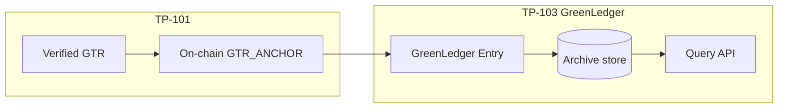

# TP-103 — GreenLedger Protocol

**Standard ID:** TP-103  
**Version:** 1.0.0  
**Status:** Draft  
**Layer:** Provenance  
**Canonical schema:** [green-ledger-spec/schema.json](../../green-ledger-spec/schema.json)

The **GreenLedger Protocol (TP-103)** defines the normative specification for the provenance and archival layer of the Tegalchain Sovereign Ecosystem. It establishes the data structures, storage requirements, query interfaces, and retention policies for long-term environmental impact records derived from **TP-101** GreenTelemetry Records (GTRs).

GreenLedger provides the canonical, tamper-evident repository of environmental history for all ecosystem participants. It is the authoritative source for carbon accounting, audit trails, and regulatory reporting within the Tegalchain network.

## Custodianless by design

One of GreenLedger's defining characteristics is what it **does not** do.

GreenLedger **MUST NOT** become the legal owner of participant assets. Implementations **SHALL NOT** take custody of off-ledger physical assets, user wallets, or Provenance Assets (PA) on behalf of participants. GreenLedger records **provenance** — tamper-evident archival of verified evidence — not title transfer.

```text
Asset owners retain custody          (TP-107 sovereign platforms, tegalid-bound nodes)
        ↓
GreenLedger records provenance       (TP-103 — GLE, Auditrail, Carbon Account views)
        ↓
Eligible provenance → Transynth tX*  (TP-102 PoRE → TP-104 PoREX mint gates)
        ↓
DAO-governed collateralization       (TP-105 Voixcoin, TP-106 TEGAL DAO)
```

| Layer | Custody rule |
|-------|----------------|
| **TP-107** producers | Nodes and asset owners retain operational and legal custody of source assets |
| **TP-101** oracle | Validates and anchors evidence; **MUST NOT** hold PA or stablecoin balances |
| **TP-103** GreenLedger | Archives GLE rows and materialised reporting views; **MUST NOT** mint tX* or Voixcoin |
| **TP-104** Transynths | On-chain provenance tokens minted only from eligible verified evidence |
| **TP-105** Voixcoin | PA locked **on-chain** under protocol rules — non-custodial collateral module |

This separation preserves **sovereignty** while enabling **decentralized trust**. A **Carbon Account** is a materialised aggregation for reporting; it is **not** a claim of ownership over emissions rights or underlying assets. Cold-tier export and replication **MUST** copy provenance records only — they **MUST NOT** relocate asset custody.

Reference: [VOIXCOIN.md](../contracts/VOIXCOIN.md), [PROTOCOL-STACK.md](../PROTOCOL-STACK.md#tp-104--transynth-standard).

## Relationship to TP-101

**TP-101** defines how environmental data is collected and anchored. **TP-103** defines how that anchored data is stored, indexed, queried, and retained over multi-year timescales.

Every GTR anchored via TP-101 **MUST** be archived in at least one TP-103-compliant GreenLedger node.



## Data model

### GreenLedger Entry (GLE)

A **GreenLedger Entry** is the archival representation of a finalized GTR.

| Field | Type | Requirement | Description |
|-------|------|-------------|-------------|
| `gle_id` | UUID v4 | MUST | Unique entry identifier |
| `gtr_id` | UUID v4 | MUST | Reference to the originating GTR |
| `ledger_ref` | string | MUST | On-chain transaction hash (`0x` + 64 hex) or Phase 1 lab ref (`LABMOCK-…`) |
| `content_hash` | string(64) | MUST | SHA-256 of the canonical GTR JSON |
| `source_id` | string(64) | MUST | Originating sensor or reporting entity |
| `measurement_type` | enum | MUST | From TP-101 measurement types |
| `value` | decimal | MUST | Measured quantity |
| `unit` | string(16) | MUST | Measurement unit |
| `measurement_timestamp` | ISO 8601 | MUST | Original measurement time |
| `anchor_timestamp` | ISO 8601 | MUST | Time of on-chain anchoring |
| `archive_timestamp` | ISO 8601 | MUST | Time of GreenLedger ingestion |
| `attestation_count` | integer | MUST | Number of attestations on the GTR |
| `attestation_summary` | JSON array | MUST | `{attester_id, attester_type, confidence?}` |
| `merkle_proof` | JSON | SHOULD | Proof of inclusion in on-chain Merkle batch |
| `tags` | list[string] | MAY | Participant-defined classification tags |
| `retention_class` | enum | MUST | `STANDARD`, `REGULATORY`, `PERMANENT` |

Wire format: `green_ledger_entry_v1` in [schema.json](../../green-ledger-spec/schema.json).

### Retention classes

| Class | Minimum retention | Use case |
|-------|-------------------|----------|
| `STANDARD` | **7 years** | Default gretelemetry / operational records |
| `REGULATORY` | **10 years** | GHG Protocol, ISO 14064, TCFD-aligned reporting |
| `PERMANENT` | No expiry | Foundational baseline or legal hold |

Implementations **MUST NOT** delete GLE rows before the retention window expires. `PERMANENT` entries **MUST NOT** be deleted.

Reference: [`green_ledger_spec/retention.py`](../../green_ledger_spec/retention.py)

### Carbon Account

GreenLedger nodes **MUST** maintain a materialised **Carbon Account** per registered source entity. The Carbon Account aggregates net emissions and offsets over rolling time windows (Phase 1: calendar month).

| Field | Description |
|-------|-------------|
| `source_id` | Entity identifier |
| `period_start` | Start of accounting period |
| `period_end` | End of accounting period |
| `gross_emissions_kgco2e` | Sum of CO2e-class emissions in period |
| `offset_credits_kgco2e` | Sum of verified offset credits in period |
| `net_emissions_kgco2e` | Gross minus offsets |
| `data_completeness` | Ratio of expected vs. received GTRs (0.0–1.0) |
| `last_updated` | Timestamp of most recent GTR contributing to this account |

Emissions are aggregated from archived GLE rows where `measurement_type` ∈ `{CO2E, CH4, N2O}`; offsets from `OFFSET_CREDIT`. Values are normalised to **kg CO2e**.

Reference: [`green_ledger_spec/carbon_account.py`](../../green_ledger_spec/carbon_account.py), [`tegalchain/greenledger/carbon.py`](../../tegalchain/greenledger/carbon.py)

## Storage architecture

### Layered storage

GreenLedger implementations **MUST** support a two-tier storage architecture:

| Tier | Age | Requirements |
|------|-----|--------------|
| **Hot** | Preceding **24 months** | Structured indexed DB; single-record query ≤ **500 ms** p95; query by `source_id`, `measurement_type`, date range, tags |
| **Cold** | Older than 24 months | Lower-cost object storage (IPFS, S3, tape); retrievable within **48 hours**; same schema and `content_hash` |

Phase 1 lab: SQLite `greenledger_entries` acts as the **hot tier** store.

Reference: [`green_ledger_spec/storage.py`](../../green_ledger_spec/storage.py)

### Replication

GreenLedger nodes **MUST** replicate data to at least **two** geographically distinct storage locations. Implementations **SHOULD** participate in the **Tegalchain GreenLedger federation** for cross-verification of archive integrity.

Phase 1: `ReplicationPolicy(min_sites=2)` documents the requirement; multi-site replication is a deployment target.

### Integrity verification

GreenLedger nodes **MUST** perform periodic integrity checks:

| Schedule | Scope |
|----------|--------|
| **Daily** | Verify `content_hash` of all hot-tier entries modified in the preceding 24 hours |
| **Weekly** | Verify a random **5%** sample of hot-tier entries |
| **Monthly** | Verify `ledger_ref` of all entries archived in the preceding month against on-chain state |
| **Annually** | Full cold-tier audit |

Any integrity violation **MUST** trigger an alert and **SHALL NOT** be silently corrected without audit logging (`greenledger_integrity_violations` table in Phase 1).

Reference: [`green_ledger_spec/integrity.py`](../../green_ledger_spec/integrity.py)

## Archival pipeline

Phase 1 archival occurs **after** on-chain submit when Auditrail correlation runs:

1. Mint worker validates GTR (TP-101) and enqueues `TELEMETRY_MINT`
2. Submitter drains queue → `ledger_ref` / `submit_ref`
3. `correlate_submitted_record()` persists Auditrail correlation
4. `archive_submitted_gtr()` builds and stores the **GLE**

Reference: [`tegalchain/auditrail.py`](../../tegalchain/auditrail.py), [`tegalchain/greenledger/archive.py`](../../tegalchain/greenledger/archive.py)

## Query interface

Phase 1 query surface (SQLite `MintQueueStore`):

| Operation | Method | Description |
|-----------|--------|-------------|
| By GTR | `fetch_greenledger_by_gtr_id(gtr_id)` | Primary lookup after ingest |
| By GLE | `fetch_greenledger_by_gle_id(gle_id)` | Entry identifier lookup |
| Filter | `query_greenledger(source_id=, measurement_type=, limit=)` | Indexed list query |
| Carbon Account | `fetch_carbon_account(source_id, period_start, period_end)` | Materialised emissions window |
| Latest Carbon Account | `fetch_latest_carbon_account(source_id)` | Most recent period |

Mint worker exposes archived GLE on `GET /v1/telemetry/records/{gtr_id}` as `greenledger_entry` when present.

Phase 7 adds `GET /v1/greenledger/carbon-accounts/{source_id}` (latest or explicit `period_start` / `period_end` query params). Requires Bearer when `TEGALCHAIN_REQUIRE_BEARER=1`.

Cosmos target: `x/auditrail` / GreenLedger module query endpoints mirroring the same fields.

## Auditrail correlation

**Auditrail** is the post-submit correlation artifact linking `gtr_id` → `submit_ref` → anchor metadata. The **GLE** is the long-retention archival row; Auditrail is the lightweight correlation index.

| Artifact | Purpose |
|----------|---------|
| Auditrail correlation | Submit ref, anchor timestamp, tegalid binding |
| GreenLedger Entry (GLE) | Full archival record for reporting and compliance |

Both are persisted on successful submit in Phase 1.

## Conformance

An implementation is TP-103 conformant if it:

1. Archives every anchored GTR as a schema-valid **GLE**
2. Stores `content_hash` matching the TP-101 canonical GTR hash
3. Records `ledger_ref`, `anchor_timestamp`, and `archive_timestamp`
4. Enforces retention class policy (7-year minimum for `STANDARD`)
5. Provides query by `gtr_id` and indexed lookup by `source_id`
6. Maintains materialised **Carbon Accounts** per source entity
7. Implements hot/cold tier classification and scheduled integrity verification
8. **Does not** take legal custody of participant assets or PA — provenance archival only ([Custodianless by design](#custodianless-by-design))

### Phase 1 profile (lab)

- SQLite `greenledger_entries` table in `MintQueueStore`
- GLE archival wired to submitter drain + Auditrail correlation
- Carbon Account refresh on each GLE archive (monthly window)
- Integrity violation log table (checks via `green_ledger_spec/integrity.py`)
- `GET /v1/telemetry/records/{gtr_id}` returns `greenledger_entry`

Full production conformance additionally requires replicated GreenLedger nodes, tamper-evident storage, and on-chain module queries.

## Implementation in this repo

| Artifact | Location | Status |
|----------|----------|--------|
| Normative spec | This document | Draft v1.0.0 |
| JSON Schema | [green-ledger-spec/](../../green-ledger-spec/) | Draft |
| Python GLE builder | [green_ledger_spec/](../../green_ledger_spec/) | Phase 1 reference |
| Carbon Accounts | [green_ledger_spec/carbon_account.py](../../green_ledger_spec/carbon_account.py) | Live |
| Hot/cold + replication | [green_ledger_spec/storage.py](../../green_ledger_spec/storage.py) | Draft policy |
| Integrity checks | [green_ledger_spec/integrity.py](../../green_ledger_spec/integrity.py) | CLI via `python -m tegalchain.greenledger integrity-check` |
| Cold-tier export | [tegalchain/greenledger/export.py](../../tegalchain/greenledger/export.py) | CLI via `python -m tegalchain.greenledger export-cold` |
| Carbon Account HTTP | [integrations/mint_worker/server.py](../../integrations/mint_worker/server.py) | `GET /v1/greenledger/carbon-accounts/{source_id}` |
| Bridge archive | [tegalchain/greenledger/](../../tegalchain/greenledger/) | Live |
| Archive store | [tegalchain/queue/store.py](../../tegalchain/queue/store.py) | Live |
| Auditrail + GLE on submit | [tegalchain/auditrail.py](../../tegalchain/auditrail.py) | Live |
| On-chain anchor payload | [tegalchain/anchor.py](../../tegalchain/anchor.py) | Live |
| Chain core (submodule) | [tegalchain-core/](../../tegalchain-core/) | Cosmos target |

## Related standards

- [TP-101-GREENTELEMETRY.md](./TP-101-GREENTELEMETRY.md) — GTR input contract
- [TP-102-PROOF-OF-RESONANCE.md](./TP-102-PROOF-OF-RESONANCE.md) — trust scoring before archive consumers
- [TEGALCHAIN.md](../TEGALCHAIN.md) — permissioned ledger core
- [PROTOCOL-STACK.md](../PROTOCOL-STACK.md) — full TP-101–107 index
