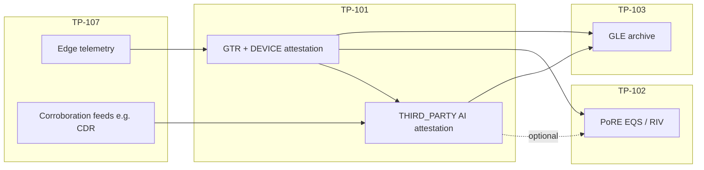

# TP-108 — AI Attestation Profile

**Standard ID:** TP-108  
**Version:** 1.0.0  
**Status:** Draft  
**Layer:** Trust adjunct (TP-101 attestation metadata; optional TP-102 PoRE input)  
**Canonical schema:** [ai-attestation-spec/schema.json](../../ai-attestation-spec/schema.json)

The **AI Attestation Profile (TP-108)** defines how machine-learning or rule-augmented **third-party attestations** attach to **TP-101 GreenTelemetry Records (GTRs)** without replacing device or operator signatures, fabricating measurements, or asserting custody or ownership.

AI attestations are **fraud-reduction and completeness signals** at the incentive layer. They MAY influence **TP-102 Proof of Resonance Evidence (PoRE)** scoring when a deployment enables an AI-aware scoring profile; they MUST NOT be the sole gate for mint eligibility, ledger anchoring, or Carbon Account totals.

## Relationship to adjacent standards

| Standard | Role |
|----------|------|
| **TP-101** GreenTelemetry | Host GTR; AI attestation lives in `attestations[].metadata.tp108` as `THIRD_PARTY` |
| **TP-102** Proof of Resonance | MAY consume verified AI claims as optional EQS modifiers (deployment-specific) |
| **TP-103** GreenLedger | Archives GLE with attestation summaries; AI metadata is part of the evidence bundle |
| **TP-107** Sovereign Platforms | Producers (Zeegate, Bytenergy) supply public inputs referenced by `inputs_hash` |



## Custodianless and exclusion rules

Implementations **MUST NOT** use TP-108 to:

| Excluded use | Reason |
|--------------|--------|
| Assert **ownership** or **custody** of edge assets | Custodianless design — see [TP-103 § Custodianless by design](./TP-103-GREENLEDGER.md#custodianless-by-design) |
| **Replace** `DEVICE` or `OPERATOR` signatures on primary measurements | AI is corroborative, not authoritative for raw sensor truth |
| **Invent** `value`, `unit`, or `measurement_type` not present in signed producer evidence | Emissions and quantities remain producer-signed |
| Serve as the **only** mint / anchor gate | Oracle tegalid gate + TP-101 validation remain mandatory |
| Override **REGULATORY** attestations | Regulatory marks take precedence in dispute resolution |

AI attestations **MAY**:

- Flag implausible combinations (e.g. bandwidth vs. billed minutes)
- Score completeness of a reporting window
- Recommend down-weighting EQS until human or REGULATORY review
- Reference **hashes of public inputs** without embedding private subscriber data on-chain or in GLE

## Wire placement (TP-101)

AI attestations use the existing TP-101 `Attestation` object:

| Field | Requirement | Value |
|-------|-------------|-------|
| `attester_type` | MUST | `THIRD_PARTY` |
| `attester_id` | MUST | Registered DID or catalog id (recommended: `did:tegal:ai:<profile>`) |
| `signature` | MUST | Ed25519 over the **same GTR canonical hash** as other attestations |
| `timestamp` | MUST | ISO 8601 UTC |
| `confidence` | SHOULD | Decimal in `[0.00, 1.00]` — model confidence for the **claim**, not measurement accuracy |
| `metadata.tp108` | MUST | Object conforming to [ai-attestation-spec/schema.json](../../ai-attestation-spec/schema.json) |

The GTR **MUST** already include at least one non-`THIRD_PARTY` attestation (`DEVICE` or `OPERATOR`) before an AI `THIRD_PARTY` attestation is considered well-formed for PoRE ingestion.

### `metadata.tp108` object

| Field | Type | Requirement | Description |
|-------|------|-------------|-------------|
| `protocol_standard` | string | MUST | Literal `"TP-108"` |
| `schema_version` | semver | MUST | `"1.0.0"` for this specification |
| `claim_type` | enum | MUST | See claim types below |
| `model_profile` | string(64) | MUST | Registered profile id (e.g. `zeegate-cdr-bandwidth-v1`) |
| `inputs_hash` | hex(64) | MUST | SHA-256 of canonical public inputs JSON |
| `verdict` | enum | MUST | `PASS`, `WARN`, `FAIL` |
| `score` | decimal | SHOULD | Normalized support score `[0.00, 1.00]` for the claim |
| `subject_gtr_id` | UUID | MAY | GTR under evaluation when attestation is batch-scoped |
| `corroboration_refs` | string[] | MAY | Content hashes or gle_ids of corroborating records |
| `rationale_uri` | URI | MAY | IPFS / HTTPS pointer to human-readable explanation (no PII) |
| `model_version` | string | MAY | Opaque model or ruleset version |
| `policy_id` | string | MAY | DAO or operator policy that authorized this attester |

### Claim types

| `claim_type` | Purpose | Typical inputs (hashed) |
|--------------|---------|-------------------------|
| `PLAUSIBILITY` | Measurement within expected physical or statistical bounds | Historical baselines, device class, geography |
| `CORROBORATION` | Independent feed aligns with producer claim | CDR ↔ bandwidth, meter ↔ inverter, two-source reconciliation |
| `COMPLETENESS` | Reporting window coverage vs. expected duty cycle | Expected intervals, fleet schedule, SLA |
| `BINDING_RISK` | tegalid binding or key-rotation anomaly | Binding age, attestation score delta, suspension flags |

`BINDING_RISK` is advisory for **tegalid** operators; it MUST NOT auto-suspend bindings without TP-107 control-plane policy.

### `inputs_hash` algorithm

1. Collect **public** inputs available to the attester (never include raw MSISDN, IMEI, or subscriber identifiers).
2. Build a JSON object with **sorted keys** at the top level; nested objects MUST also use sorted keys.
3. Serialize with UTF-8, no insignificant whitespace: `json.dumps(obj, sort_keys=True, separators=(",", ":"))`.
4. `inputs_hash` = lowercase hex SHA-256 of that byte string.

Verifiers **MUST** reject attestations when recomputed hash ≠ declared `inputs_hash`.

## Attester registration (recommended)

| Field | Description |
|-------|-------------|
| `attester_id` | Stable DID in project registry or `tegalchain/data/ai_attesters.example.json` (lab) |
| `model_profile` | One profile per attestation use case |
| `public_key` | Ed25519 verify key for `THIRD_PARTY` signatures |
| `max_confidence` | Upper bound the attester MAY emit (default `0.95` for ML; `1.00` for deterministic rules) |

Lab deployments MAY use a single shared attester key; production SHOULD rotate keys via tegalid-style binding updates.

## TP-102 PoRE ingestion (optional)

TP-108 does **not** change Phase 1 oracle scoring by default (`ScoringProfile.PHASE1_ORACLE`). When a deployment enables **`ScoringProfile.AI_AUGMENTED`** (future profile):

| AI `verdict` | Suggested EQS modifier | Notes |
|--------------|------------------------|-------|
| `PASS` + `CORROBORATION` | +0.05 to +0.15 capped | Requires `confidence` ≥ 0.80 |
| `WARN` | −0.05 to −0.20 | Mint MAY proceed; PoREX thresholds MAY block tX* |
| `FAIL` | −0.30 or exclude from PoREX | Anchor MAY still proceed if TP-101 valid |

Governance (**TP-106**) SHOULD set network-wide floors/ceilings for modifiers. Until on-chain params exist, operators configure modifiers in mint worker / scoring config only.

**RIV** (resilience / integrity vector) MUST NOT be fully delegated to AI; at most one RIV sub-factor MAY reference `COMPLETENESS` claims.

## Reference profile: Zeegate CDR ↔ bandwidth corroboration

**Profile id:** `zeegate-cdr-bandwidth-v1`  
**Platform:** TP-107 Zeegate DePIN — see [ZEEGATE-DEPIN-CONTROL-PLANE.md](../platforms/ZEEGATE-DEPIN-CONTROL-PLANE.md)

| Input | Source | Notes |
|-------|--------|-------|
| Edge bandwidth GTR | `source_id` = edge node | `CUSTOM` or `ENERGY_KWH` proxy metrics from gretelemetry |
| CDR aggregate | `zeegate-cloud/cdr_adapter` | Session counts / duration buckets per edge window — hashed, no MSISDN |
| Binding | tegalid `NodeBinding` | `binding_id`, attestation score |

**Claim:** `CORROBORATION`  
**Pass criterion (deterministic v1):** billed-minute equivalent within `[0.5×, 2.0×]` of bandwidth-implied active minutes for the same UTC window.  
**Warn:** outside band but within `[0.25×, 4.0×]`  
**Fail:** outside warn band or missing CDR window

Example public inputs object (pre-hash):

```json
{
  "binding_id": "bind-edge-001",
  "cdr_sha256": "a1b2c3…",
  "edge_source_id": "did:tegal:LABEDGE001",
  "gtr_id": "5d8528c0-ce18-4a13-9be9-59fedb095049",
  "model_profile": "zeegate-cdr-bandwidth-v1",
  "window_end": "2026-07-25T12:00:00Z",
  "window_start": "2026-07-25T11:00:00Z"
}
```

Attestation attaches to the **edge bandwidth GTR** as `THIRD_PARTY` with `metadata.tp108.claim_type = "CORROBORATION"`.

## Lab integration sketch

Formal phase doc: [PHASE-8.md](../phases/PHASE-8.md).

Phase 7 lab flows remain valid **without** AI attestations. Optional hook:

1. After `phase7-staging-ingest.sh` accepts a GTR, run `./scripts/phase8-ai-attest-stub.sh [gtr_id]` to append a signed `THIRD_PARTY` attestation using the lab attester key.
2. Mint worker validates TP-108 schema on append when `MINT_WORKER_VALIDATE_TP108=1`.
3. `GET /v1/telemetry/records/{gtr_id}` returns full attestations including `metadata.tp108.claim_type` and `verdict`.

No lab script is required for TP-108 conformance; producers MAY omit AI attestations entirely.

## Versioning

| Version | Changes |
|---------|---------|
| **1.0.0** | Initial draft — claim types, metadata schema, Zeegate reference profile, PoRE optional modifiers |

## See also

- [TP-101 — GreenTelemetry](./TP-101-GREENTELEMETRY.md)
- [TP-102 — Proof of Resonance](./TP-102-PROOF-OF-RESONANCE.md)
- [PROTOCOL-STACK.md](../PROTOCOL-STACK.md)
